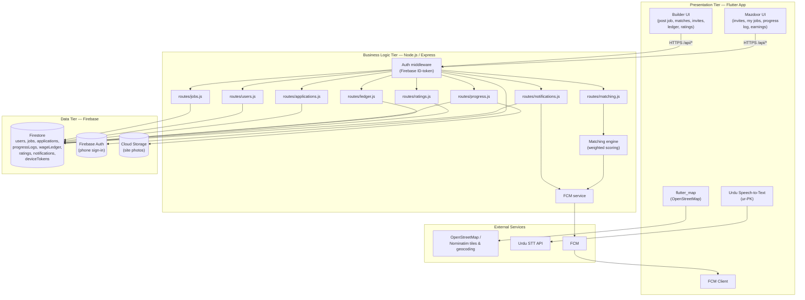
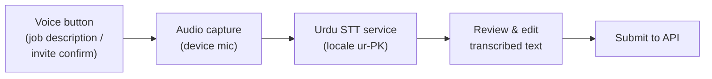

# System Architecture — Mazdoor Sathi

**Version:** 1.0 — October 2026
Companion to `SRS.md`, `DATABASE.md`, `API.md`.

---

## 1. Three-Tier Architecture

Mazdoor Sathi follows a three-tier client–server architecture (per the approved proposal):



- **Presentation tier** (`app/`): single Flutter codebase with role-specific screens; `ApiClient` calls the REST API; `LocationService`, `SpeechService`, `NotificationService` wrap platform integrations.
- **Business tier** (`backend/`): Express routers per domain; all business rules (matching scores, ledger totals, status transitions, rating aggregation) live in the route modules; Firestore accessed via Firebase Admin SDK.
- **Data tier**: Firestore for real-time documents, Cloud Storage for compressed site photos, Firebase Auth for phone-based identity.

---

## 2. End-to-End Request Flow

The canonical lifecycle — **post job → match → invite → accept → assign → progress → payment → rating** — mapped to API endpoints. Job status moves per the backend `STATUS_FLOW`:

```
draft → open | cancelled
open → assigned | cancelled
assigned → in_progress | cancelled
in_progress → completed | cancelled
completed → closed
```

Field and collection names follow `docs/DATABASE.md`.

```mermaid
sequenceDiagram
    participant B as Builder App
    participant API as Express API
    participant FS as Firestore
    participant M as Mazdoor App

    B->>API: POST /api/jobs (tradesRequired, siteLat/siteLng, city)
    API->>FS: create jobs (status=open)
    B->>API: GET /api/jobs/:id/matches
    API->>FS: query available mazdoors
    API->>API: score candidates (tradeMatch/rating/proximity/wageFit)
    API-->>B: ranked matches + breakdown
    B->>API: POST /api/jobs/:id/invite {mazdoorId, trade}
    API->>FS: create applications (status=invited)
    M->>API: GET /api/users/me/applications
    M->>API: POST /api/applications/:id/respond {action: accept}
    API->>FS: application accepted
    B->>API: GET /api/jobs/:id/applications
    B->>API: PATCH /api/jobs/:id {status: assigned, assignedTeam: [...]}
    API->>FS: job assigned (each member verified against an accepted application)
    B->>API: PATCH /api/jobs/:id {status: in_progress}
    M->>API: POST /api/jobs/:id/progress {date, note, photoUrls, percentComplete}
    API->>FS: create progressLogs entry
    B->>API: GET /api/jobs/:id/progress
    B->>API: PATCH /api/progress/:logId {approved: true}
    B->>API: POST /api/jobs/:id/ledger {mazdoorId, date, daysWorked, dailyWage, ...}
    API->>FS: wageLedger entry (gross/net computed)
    B->>API: PATCH /api/ledger/:entryId {paid: true}
    B->>API: PATCH /api/jobs/:id {status: completed}
    B->>API: POST /api/jobs/:id/ratings {rateeId, stars, comment}
    M->>API: POST /api/jobs/:id/ratings {rateeId, stars, comment}
    API->>FS: ratings; recalc users.ratingAvg/ratingCount
```

Data notes: `POST /api/jobs` stores the `tradesRequired[]` array on the `jobs` document and denormalises `tradeList[]`; invite acceptance sets `applications.status = accepted` with `respondedAt`; each daily update creates a `progressLogs` document carrying `photoUrls[]`, `percentComplete`, `approved` (null = pending), and `flagged`; ledger entries carry server-computed `gross`/`net`.

### 2.1 Endpoint coverage

Every endpoint in `docs/API.md` §9 is exercised by the flows in this document:

| Area | Endpoints |
|---|---|
| Profiles | `POST /api/users/profile`, `GET /api/users/me`, `GET /api/users/:id`, `POST /api/users/me/device-token` |
| Jobs | `POST /api/jobs`, `GET /api/jobs` (incl. `?mine=true`), `GET /api/jobs/:id`, `PATCH /api/jobs/:id` (status flow), `DELETE /api/jobs/:id` |
| Matching & invites | `GET /api/jobs/:id/matches` (§3 scoring), `POST /api/jobs/:id/invite` |
| Applications | `GET /api/applications/:id`, `GET /api/jobs/:id/applications`, `GET /api/users/me/applications`, `POST /api/applications/:id/respond` |
| Progress | `POST /api/jobs/:id/progress`, `GET /api/jobs/:id/progress`, `PATCH /api/progress/:logId` (approve/flag review) |
| Wage ledger | `POST /api/jobs/:id/ledger`, `GET /api/jobs/:id/ledger` (entries + perWorker + totals), `GET /api/ledger/mine`, `PATCH /api/ledger/:entryId` |
| Ratings | `POST /api/jobs/:id/ratings`, `GET /api/users/:id/ratings` (reputation → `users.ratingAvg`) |
| Notifications | `POST /api/notify` (FCM fan-out via `deviceTokens`, §6), `GET /api/users/me/notifications`, `PATCH /api/notifications/:id/read` |

---

## 3. Matching Algorithm

`GET /api/jobs/:id/matches` ranks available mazdoors for a job using a weighted score (0–100):

```
score = tradeMatch(/40) + rating(/25) + proximity(/25) + wageFit(/10)
```

The API returns this as `score` (0–100) with a per-component `breakdown` map so builders can see why a candidate ranked where they did:

```json
{ "mazdoor": { …public profile… }, "distanceKm": 3.2, "score": 87.5,
  "breakdown": { "tradeMatch": 35.0, "rating": 21.5, "proximity": 20.0, "wageFit": 10.0 } }
```

| Component | Weight | Computation |
|---|---|---|
| `tradeMatch` | 40 | Share of the job's required trades the mazdoor covers: `(overlap / requiredTrades) × 40`. Candidates covering zero required trades are filtered out |
| `rating` | 25 | `(ratingBase / 5) × 25`; unrated workers (`ratingCount = 0`) get a neutral `ratingBase = 3.0` |
| `proximity` | 25 | `(1 − distanceKm / radiusKm) × 25` — linear falloff from the job site to the search radius (default 25 km); Haversine distance on `users.location` vs `jobs.siteLocation` |
| `wageFit` | 10 | 10 if the mazdoor's `dailyWage` is null or ≤ the job's average `wageOffer`; 5 if ≤ 1.5× the average offer; 0 otherwise |

**Process:**
1. Candidate pool: `users` where `role = "mazdoor"` and `availability = true` (capped at 300).
2. Exclude mazdoors without a `location`, beyond `radiusKm`, or with no trade overlap with the job's `tradesRequired`.
3. Score, sort descending, return the top `limit` (default 20) with `distanceKm` and `breakdown` for transparency.

Complexity is O(C) with C candidates (≤ 300 after the pool cap); Firestore pre-filtering keeps C small, satisfying NFR-1 (≤ 3 s for 500 candidates).

---

## 4. Urdu Speech-to-Text Integration



- Used for the **job description field** during posting and the **accept/confirm** action on invites (SRS FR-27/FR-28).
- The Flutter `SpeechService` requests mic permission, streams audio to the STT provider with locale `ur-PK`, and returns transcribed text into the form field.
- The user **always reviews and can edit** the transcription before submit — no voice input is sent to the backend unreviewed.
- Fallback: if STT is unavailable (no network, permission denied), the field degrades gracefully to typing.

---

## 5. Location & OpenStreetMap Approach

- **Map rendering:** `flutter_map` with OSM raster tiles; the job site (`jobs.siteLocation`) and mazdoor home locations (`users.location`) rendered as markers.
- **Profile location:** set once at profile setup (or updated later) via `POST /api/users/profile` with `lat`/`lng`; stored as `users.location = {lat, lng}` and used for proximity matching.
- **Nearby jobs:** the mazdoor home screen calls `GET /api/jobs?status=open` and filters client-side to jobs within 25 km of the device position (Haversine), since the backend has no geo-query endpoint.
- **No live tracking:** there is no worker live-location endpoint in the API; location data is profile-level only.
- **No Google Maps dependency:** keeps the project at zero mapping cost (proposal §8).

---

## 6. Testing Plan — Simulated Multi-Trade Scenarios

Per proposal objective 8 ("test the prototype using simulated multi-trade construction scenarios"), testing uses seeded Firestore data (simulated builders, mazdoors, jobs) rather than real users.

| ID | Scenario | Steps (abridged) | Verifies |
|---|---|---|---|
| TS-1 | Multi-trade team hiring | Seed 30 mazdoors (masons, electricians, plumbers); post a job requiring Mason ×2 + Electrician ×1; run matching; invite | FR-6/7/10/11, `POST /api/jobs`, `GET /api/jobs/:id/matches`, `POST /api/jobs/:id/invite` |
| TS-2 | Invite → accept → assign → start | Accept invites via `POST /api/applications/:id/respond`; builder assigns team and starts job (`PATCH /api/jobs/:id` with `assignedTeam`, then `{status: in_progress}`) | FR-12/13/15, status lifecycle FR-9 |
| TS-3 | Daily photo progress | Each hired mazdoor submits 5 daily `POST /api/jobs/:id/progress` entries (photo + note + percentComplete); builder views timeline `GET /api/jobs/:id/progress` and reviews with `PATCH /api/progress/:logId` | FR-18/19 |
| TS-4 | Wage ledger | Builder records entries (`POST /api/jobs/:id/ledger`); marks paid (`PATCH /api/ledger/:entryId`); check totals via `GET /api/jobs/:id/ledger`; mazdoor checks `GET /api/ledger/mine` | FR-20–23 |
| TS-5 | Completion & two-way ratings | Complete job; exchange ratings (`POST /api/jobs/:id/ratings`); assert `users.ratingAvg` recomputed and reflected in a follow-up match run | FR-24–26 |
| TS-6 | Nearby jobs & Urdu voice | Seed jobs across cities; verify client-side 25 km nearby filter on `GET /api/jobs?status=open`; run Urdu STT on sample phrases for job description and invite confirmation, measuring transcription usability | FR-16/17/27/28, NFR-5 |

**Test types:** unit tests for the matching scorer and ledger totals; API integration tests per endpoint table in `API.md` §9; manual UI walkthroughs of the post → match → invite → accept → progress → payment → rating flow on Android emulator with seeded data.

---

## 7. Future Work

- In-app payment integration (Easypaisa/JazzCash) to settle ledger balances digitally.
- iOS build of the Flutter app.
- Web admin dashboard for supervisors managing multiple sites.
- Dispute-resolution workflow for contested ledger entries and ratings.
- ML-based wage estimation from historical job data.
- Background verification / skill certification badges for mazdoors.
